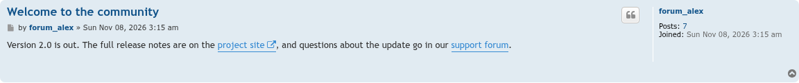
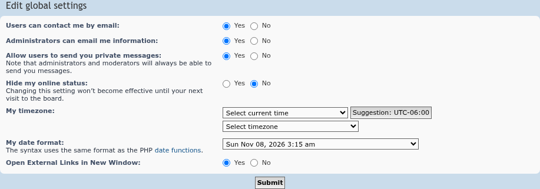

# External Links Open in New Window

 

Opens external links in a new window.

## Features

- Clicking a link to another site (`http`, `https` or `ftp`) opens it in a new window or tab. Links to the board's own site, its subdomains included, open as usual.
- Links in posts and signatures that lead to other sites get an icon and an "Opens in new window" note, which screen readers announce too.
- Link forums that point to other sites open in a new window as well.
- Tells sites apart with the [Public Suffix List](https://publicsuffix.org/), so two unrelated sites such as `example.com.br` and `other.com.br` count as different sites. The list ships with the extension; no outside request is made.
- Leaves lightbox, share and other script-driven links alone.
- Each member can turn it off under **UCP → Board preferences → Edit global settings**. It is on by default.

## Screenshots

<table>
<tr>
<td></td>
<td></td>
</tr>
</table>

Click an image for the full size. See the [screenshot gallery](docs/images/screenshots/README.md) for captions.

## Requirements

- phpBB 3.3.19 or later, including phpBB 4.0 (tested on its 4.0.0-a3 development version)
- PHP 8.3.36 or later

## Installation

1. Copy the extension to `/ext/phpbbmodders/elonw`
2. In the Administration Control Panel, go to **Customise → Manage extensions**
3. Enable the **External Links Open in New Window** extension

### Upgrading from `rmcgirr83/elonw`

This extension used to be installed as `rmcgirr83/elonw`. Members' settings carry over:

1. Disable the old **External Links Open in New Window** extension in the ACP. Do **not** delete its data.
2. Upload this version to `/ext/phpbbmodders/elonw` and enable it. The old install's migration history is moved to the new name automatically.
3. Delete the `/ext/rmcgirr83/elonw` folder and purge the board cache.

If you disable the old extension from the command line (`bin/phpbbcli.php`) instead of the ACP, run `bin/phpbbcli.php cache:purge` before enabling the new one; the command-line disable doesn't clear the cache.

## Contributing

Contributions are welcome!

- **Bug reports**: [Open an issue](https://github.com/phpbbmodders/elonw/issues).
- **Everything else** (questions, feature requests, ideas, general discussion): [Use Discussions](https://github.com/orgs/phpbbmodders/discussions), or the [community forum](https://www.phpbbmodders.com/community/).
- Pull requests are welcome for bug fixes or discussed features.

## Acknowledgments

- Original extension by Rich McGirr ([RMcGirr83](https://github.com/rmcgirr83)).
- Public suffix lookup by [tldts](https://github.com/remusao/tldts) (MIT), with data from the [Public Suffix List](https://publicsuffix.org/).
- Code review, bug fixes, and documentation assisted by [Claude](https://www.anthropic.com/claude).
- Registrable-domain link detection assisted by [Codex](https://openai.com/codex/).

## License

This extension is licensed under the **GNU General Public License v2.0**.

See [LICENSE.txt](LICENSE.txt) for more information.
