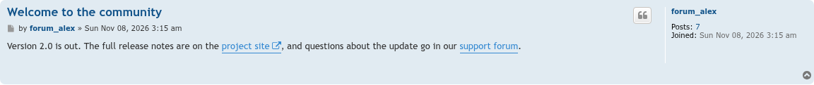
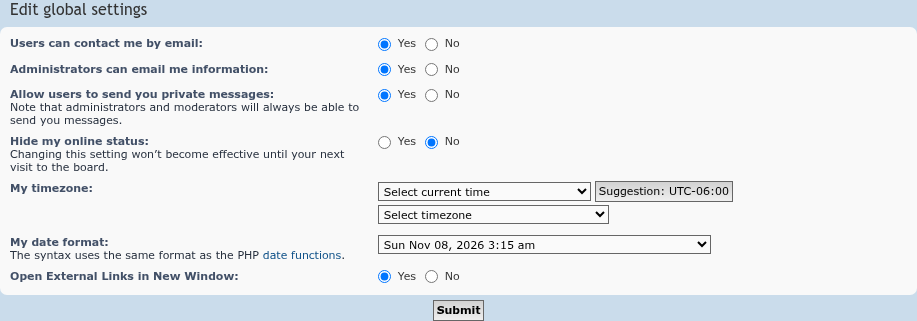

# External Links Open in New Window screenshots

Taken on phpBB 3.3.19 with prosilver and seed-forum's standard fixtures.

## A post with links

The link to the project site leads to another site, so it gets the new-window icon and opens in a new window. The link to the support forum stays on the board and opens as usual.

## The UCP setting

Members can turn the extension off under **UCP → Board preferences → Edit global settings**. It is on by default.

