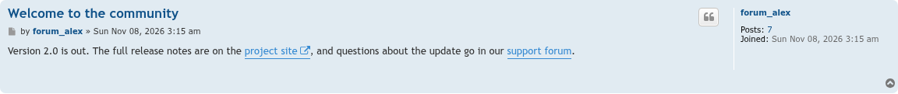
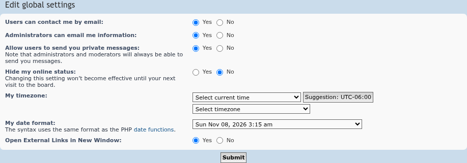

# External Links Open in New Window update screenshots — 11/07/2026

The first phpBB Modders development build, 1.1.0-dev.

The link to the project site leads to another site, so it gets the new-window icon and opens in a new window; screen readers now also hear that it opens in a new window. The link to the support forum stays on the board and opens as usual.

Members can still turn the extension off under UCP » Board preferences » Edit global settings; the setting is now always stored as on or off.

